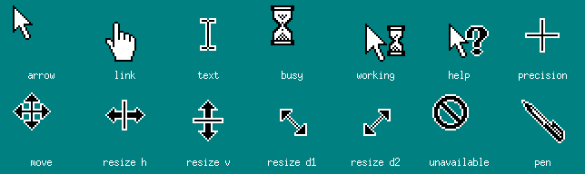

# chicago95-cursors

Just the **cursor themes** from [grassmunk/Chicago95](https://github.com/grassmunk/Chicago95),
packaged as a Nix flake. You get the Windows 95 pointers without the rest of
the Chicago95 GTK theme, icons and fonts.

<p align="center"></p>
<p align="center"><sub><code>Chicago95_Standard_Cursors</code>, 32 px native, shown at 2×</sub></p>

## Themes

All seven upstream variants are included. Each one is standalone, with no `Inherits=`.

| Theme name (directory) | Display name | Native size |
|---|---|---|
| **`Chicago95_Standard_Cursors`** | Chicago 95 Standard | 32 |
| `Chicago95_Standard_Cursors_Black` | Chicago 95 Standard Black | 32 |
| `Chicago95_Animated_Hourglass_Cursors` | Chicago 95 Animated Hourglass | 32 |
| `Chicago95_Animated_Hourglass_Cursors_HiDPI` | Chicago 95 Animated Hourglass HiDPI | 64 |
| `Chicago95_Cursor_Black` | Chicago 95 Black | 32 |
| `Chicago95_Cursor_White` | Chicago 95 White | 32 |
| `Chicago95_Emerald` | Chicago 95 Emerald Green | 32 |

## Install

```nix
# flake.nix
inputs.chicago95-cursors = {
  url = "github:Gustlik501/chicago95-cursors";
  inputs.nixpkgs.follows = "nixpkgs";
};

nixpkgs.overlays = [ inputs.chicago95-cursors.overlays.default ];  # pkgs.chicago95-cursors
```

Home Manager:

```nix
home.pointerCursor = {
  package = pkgs.chicago95-cursors;
  name = "Chicago95_Standard_Cursors";
  size = 32;
  gtk.enable = true;
  x11.enable = true;
};
home.sessionVariables = {
  XCURSOR_THEME = "Chicago95_Standard_Cursors";
  XCURSOR_SIZE = "32";
  HYPRCURSOR_THEME = "Chicago95_Standard_Cursors";
};
```

On plain NixOS, add `environment.systemPackages = [ pkgs.chicago95-cursors ];`
and select the theme in your desktop's settings.

**Use 32 px.** Every chunk in the Standard theme is 32×32, so other sizes get
scaled. The HiDPI variant contains only 64×64 images.

### Hyprland

These are **Xcursor** themes, not hyprcursor themes, and no conversion is
needed. When hyprcursor can't load a theme, Hyprland falls back to its Xcursor
loader (see the
[CursorManager source](https://github.com/hyprwm/Hyprland/blob/b6633c41/src/managers/CursorManager.cpp)).
Set both variables above so that Hyprland and X11 clients agree. They must be
set before the compositor starts, so log out and back in after changing them.

## What gets installed

- `share/icons/<theme>/{index.theme,cursors/}` with upstream's symlinks preserved
- `share/doc/chicago95-cursors/` containing the upstream README and CREDITS

The source is pinned to Chicago95 master
`5da19b8b1e2a886ebf6628403023d5fac3acc3ee` (2026-10-01) and fetched with a
sparse checkout of `Cursors/` only.

<details>
<summary><b>Verification</b></summary>

```sh
nix build
nix flake check
nix develop --command python verify.py
```

`verify.py` checks every cursor file header, all symlink targets, theme names
and native sizes. `xcur2png` extracts the Standard `left_ptr`, `hand2`, `xterm`
and `watch` cursors cleanly. The preview above is rendered directly from the
packaged Xcursor files.

</details>

## License

Chicago95 is licensed **GPL-3.0-or-later / MIT**, as declared in its README. No
cursor-specific license file overrides that, and both are recorded in
`meta.license`. All credit for the artwork goes to the
[Chicago95 contributors](https://github.com/grassmunk/Chicago95).

---

Part of a small retro-desktop set for Hyprland:
[hypr-wmdeco](https://github.com/Gustlik501/hypr-wmdeco) ·
[irixium-gtk-theme](https://github.com/Gustlik501/irixium-gtk-theme) ·
**chicago95-cursors** ·
[misc-fixed-ttf](https://github.com/Gustlik501/misc-fixed-ttf) ·
[nextlike-icons](https://github.com/Gustlik501/nextlike-icons)
